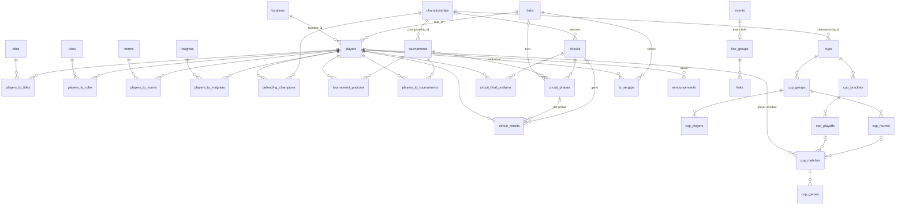

The schema lives in `packages/db/src/schema`, one file per table. Column names
are `snake_case` in SQL and `camelCase` in Drizzle. Every table has an integer
`id`, plus `created_at` and `updated_at` text timestamps in UTC.

## Entities

### People and affiliation

- **Player** (`players`): a registered chess player. Holds the three FSX
  ratings (`blitz`, `rapid`, `classic`, default 1900, range 0–4000), `active`
  (only active players appear in rankings), `verified`, optional `nickname`
  (unique), `cbx_id` and `fide_id` (unique), `birth_year` (integer; the full date is never stored), `sex`
  (`male` or `female`), photo, club, and location. `normalized_name` is the
  name lowercased without accents, used for search; the API keeps it in sync.
- **Club** (`clubs`): a chess club or school, with an optional logo (uploaded to R2 or an external URL). Schools
  in the School Games are clubs.
- **Location** (`locations`): a `city`, `state`, or `country`, with an optional
  flag (uploaded to R2 or an external URL).

### Recognition

- **Title** (`titles`): an `internal` title (awarded by the FSX, such as GMS) or
  an `external` one (CBX/FIDE, such as CM). Linked to players through
  `players_to_titles`. See [Titles](/guide/titles).
- **Role** (`roles`): a `management` (board), `referee` (arbiter), or `teacher`
  position, with a unique short name. Linked through `players_to_roles`; the
  members page reads these.
- **Norm** (`norms`): a result counting toward a state title. Linked through
  `players_to_norms`.
- **Insignia** (`insignias`): a badge with a numeric `level`. Linked through
  `players_to_insignias`.

### Competitions

- **Championship** (`championships`): a recurring competition, such as the
  Sergipe Open. Groups tournaments, cups, and circuit seasons across years.
  One-off tournaments have no championship.
- **Tier** (`tournaments.tier`, `circuits.tier`): `S` for the Sergipano
  championships, `A` and `B` for other events by importance, `school` for school
  events. Weights podium XP and groups achievements; see [Gamification](/reference/gamification).
- **Tournament** (`tournaments`): one event with a `rating_type`, a tier, an
  optional `date` and Chess-Results URL, an optional championship, and an optional
  scoring scheme (the default points of a School Games edition). `has_podiums`
  (default true) says whether the event ranks players: when off it accepts no
  podiums and the circuit and School Games syncs skip it. Turning it off needs its
  hand-entered podiums removed first and deletes the synced ones; turning it on
  syncs again. The category on a podium is optional per row.
- **Category** (`categories`): a row, not an enum, so a new category needs no
  migration. `kind` is `age` (a `sex` and an `age_limit`, e.g. `Sub 10 Feminino`
  is female with limit 10) or `open` (Futuro, Juvenil, Master: no sex or age, and
  winning one earns no champion emblem). Podium and result tables store the
  category `name`, a foreign key with `ON UPDATE CASCADE` (renaming a category
  renames it everywhere) and `ON DELETE RESTRICT`. The API checks every name
  (`BAD_REQUEST` for an unknown one).
- **Scoring scheme** (`scoring_schemes`, `scoring_scheme_places`): points by place.
  A circuit or a tournament points at one, and entry forms prefill points from it.
  Every result still stores its own points, so editing or replacing a scheme never
  rewrites history and tied players can share points.
- **Tournament podium** (`tournament_podiums`): a player's final `place` in a
  tournament, overall (`category` null) or in one category (for example
  `Sub 18 Masculino`). Any tournament can have podiums; the champions gallery
  shows the overall podiums of championship tournaments. Any place can be stored
  (the public tournament page lists the rest), but only the first `MEDAL_PLACES` (3)
  earn a medal on the player page, in medal counts, and in the podium sync below. A stage result of any
  circuit with place 1–3 creates its podium automatically, unless the stage's tournament has podiums turned off
  (`circuit_result_id` links the two): saving, moving, or deleting the result,
  or changing its phase's tournament, updates the podium, and the synced row
  replaces a hand-entered podium for the same player, tournament, and category.
  Synced podiums are read-only in the tournament's Podiums panel; edit the stage
  result instead. When one tournament is a stage of two circuits, the first
  synced result keeps the podium. `circuits.syncPodiums` rebuilds a circuit's podiums
  (the "Sync medals" button), for example for results saved before the sync existed.
- **Defending champion** (`defending_champions`): the current holder of a
  championship.
- **Rating history** (`players_to_tournaments`): the rating a player had before
  a tournament and the variation it produced. See
  [rating history](#ratings-and-rating-history).
- **Circuit** (`circuits`): one season (`year`) of a ranking across several
  tournaments, optionally linked to the championship that groups its seasons.
  Its `type` (`default`, `categories`, `school`, or `geral`) selects the
  [layout](/guide/circuits#circuit-types). A season is in progress until
  `finished_at` is set.
  - **Circuit categories** (`circuit_categories`): the categories a circuit uses. Empty means any
    category is accepted; once it has rows, its results and final podiums must use one of them
    (`BAD_REQUEST` otherwise), and a new list cannot leave out a category its results already use
    (`CONFLICT`). Results without a category are always accepted.
  - **Circuit phase** (`circuit_phases`): one stage, played at a tournament,
    optionally hosted by a club, ordered by `sort_order`.
  - **Circuit result** (`circuit_results`, formerly `circuit_podiums`): points for a
    player, attached to **either** a phase **or** directly to the circuit
    (`geral` circuits), with an optional stage place (1–1000) and category.
    Standings are the sums of these points. Each result also stores the `club_id` the
    player had when it was saved, so a player who changes club mid-season leaves the
    earlier points with the old club; the club ranking groups by it, and the result form
    can override it.
  - **Circuit final podium** (`circuit_final_podiums`): the official top 3 of a
    finished season, per category for `categories` and `school` circuits.
    Snapshotted from the standings when the season is finished, then editable,
    so champions do not change when stage points do.
- **Cup** (`cups`): a bracket-and-group competition with a prize pool and rating
  type. See [Cups](/guide/cups).
  - **Group** → **cup players** and **rounds** → **matches** → **games**.
  - **Bracket** (`UB` upper, `LB` lower, `GF` grand final) → **playoffs**
    (named phases) → **matches** → **games**.
  - A match belongs to a round or to a playoff, has two players, a `best_of`,
    and an optional winner.
- **School Games result** (`tv_sergipe`): one placement in the TV Sergipe School
  Games. See [school scoring](#school-games-scoring).

### Publishing

- **Post** (`posts`): a news article with a unique `slug`, Markdown content, an
  optional image, and `published`. Only published posts are public.
- **Announcement** (`announcements`): an official notice numbered per year;
  `(year, number)` is unique. It may name the one player it is about
  (`player_id`), which lists it on that player's profile.
- **Event** (`events`): an upcoming event with a `start_date`. Its links
  (regulations, registration form, results) live in one link group owned by the
  event.
- **Link group** and **link** (`link_groups`, `links`): labeled groups of links,
  all listed on `/links`; an event's group is labeled with the event name. A link has a `type` (`link`,
  `regulation`, `form`, or `results`), an icon from a fixed allowlist, and a
  `sort_order`.

### System tables

`user`, `session`, `account`, and `verification` belong to Better Auth.
`d1_migrations` is the migration tracker. None of them is exposed by public procedures.

## Relationships

## Deletion behavior

D1 enforces foreign keys. A delete that a reference blocks fails with a
foreign-key error, which the API returns as `CONFLICT`.

| Deleting a… | Also deletes | Blocked while referenced by |
| ----------- | ------------ | --------------------------- |
| player (no API procedure) | title, role, norm, and insignia links; ranking snapshots | announcements, rating history, tournament podiums, circuit results and final podiums, defending champions, cup players and matches, School Games results |
| club | — | players, circuit phases, School Games results |
| category | — | tournament podiums, circuit results, final podiums, circuit category lists using it |
| scoring scheme | its places | circuits and tournaments pointing at it |
| location | — | players |
| title, role, norm, insignia | its player links | — |
| championship | its defending champions | tournaments, cups, circuits |
| tournament | — | rating history (revert it first), podiums (remove them first), circuit phases |
| circuit | its phases and their results (and the tournament podiums they synced), and its own results | final podiums (reopen the season first) |
| circuit phase | its results (and the tournament podiums they synced) | — |
| cup | groups, players, rounds, brackets, playoffs, matches, games | — |
| event | its link group and links | — |
| link group | its links | — |
| post, announcement | — | — |

Rating history and School Games results are never deleted as a side effect:
a tournament with rating results must have them reverted first (see
[corrections](#corrections)), and a school with results must have them deleted
first. A tournament with results also cannot change its rating type.

A deleted player in a School Games individual result would set `player_id` to
null, which the participant check then rejects, so in practice the player
cannot be removed while such a result exists.

## Ratings and rating history

A player has three current ratings, one per `rating_type`: `blitz`, `rapid`,
and `classic`. A tournament has exactly one rating type.

The rating update (`playersTournament.linkWithRating`, used by the dashboard's
**Rating update** import) records one tournament result:

1. The tournament must exist and have the same rating type as the update.
2. The new rating is `old + variation` and must stay within 0–4000.
3. The player's rating is updated **only if it still equals the value read**
   (compare-and-swap). Otherwise the call returns `CONFLICT`: another edit
   happened in between, so reload and retry.
4. The history row is inserted in the same D1 batch, guarded by `changes() = 1`,
   so it exists only when the rating update applied
   ([ADR 0004](/decisions/0004-d1-rating-batch)).

### The history chain

A player's history rows of one rating type form a chain in **insertion (`id`)
order**, which is the order the results were applied (not the tournament date):

- each row's `old_rating` equals the previous row's `old_rating + variation`
  (the first row starts from the player's rating before any import);
- the last row's `old_rating + variation` equals the player's current rating.

**Import tournaments in date order.** Each variation is calculated from the
player's rating at that moment, so the chain follows import order on purpose.
A tournament imported late (after a newer one) is still consistent: it was
applied to the rating the player had when it was imported, and it appears after
the newer tournament in the history. Putting it back in date order would change
the starting rating of every tournament after it, and their variations would
then need recalculating outside the site.

Invariants:

- At most one history row per `(player, tournament)`; recording the same
  tournament twice returns `CONFLICT`.
- `old_rating` is within 0–4000 and `variation` within −4000 to 4000.
- A history row's `rating_type` equals its tournament's.
- The chain holds. `players.update` can still set a rating by hand without
  writing history; the dashboard only sends a rating it was asked to change, and
  `packages/db/src/audits/rating-history-sync.sql` lists every break.

### Corrections

Never fix a result by deleting the tournament or editing the rating by hand.
Each correction runs as one D1 batch, computes its delta from the stored row
inside the batch, and keeps the chain intact:

| Procedure | Dashboard | Effect |
| --------- | --------- | ------ |
| `playersTournament.correctVariation` | Player → Rating history → Save | Sets the new variation; shifts the current rating and every later row's `old_rating` by the difference. |
| `playersTournament.remove` | Player → Rating history → Remove | Deletes the row; subtracts its variation from the current rating and every later row's `old_rating`. |
| `playersTournament.revertTournament` | Tournament → Rating results → Revert all | Does `remove` for every participant; the corrected file can then be imported again. |

Later variations are kept as recorded: the federation computes them outside the
site, and a small change in the starting rating does not change them.
A correction that would push the current rating or any later `old_rating` out
of 0–4000 is rejected and changes nothing.

The [K-factor rules](/guide/rating-variation) decide the variation; the site
stores the result and does not compute it.

## Merging players

`players.merge` folds a duplicate record into another (the lowest ID survives)
in one D1 batch, so a failure leaves both records untouched.

1. It refuses when the two players overlap on a unique key: a rating result in the
   same tournament, a tournament podium in the same tournament and category, a
   final circuit podium in the same circuit and category, or a School Games result
   in the same age group and sex.
2. It clears the other record's `nickname`, `cbx_id`, and `fide_id` (unique
   columns) before the kept record inherits any profile field that is empty.
3. It re-points rating history, tournament and circuit podiums, final podiums, cup
   players, School Games results, announcements, and cup matches and games to the
   kept player. Titles, roles, norms, insignias, and defending championships move
   unless the kept player already has the same one; the rest are deleted with the
   other record.
4. It rebuilds each rating type's chain from both histories in `id` order and sets
   the kept player's ratings to the chain's end.
5. After the batch it deletes the other record's uploaded photo from R2, unless the
   kept player inherited it.

`players.rebuildRatings` runs step 4 alone for one player.

## School Games scoring

A `tv_sergipe` row is one placement:

- `tournament_id` is the edition (for example "TV Sergipe 2027"); one tournament holds
  both modalities and all 12 age/sex categories. It is null only for results saved
  before editions existed; `tvSergipe.assignEdition` moves those into a tournament.
- `club_id` is the school; `age_group` is `8`, `10`, `12`, `14`, `16`, or `18`;
  `sex` is `male` or `female`; `modality` is `individual` or `team`.
- Individual rows name a `player_id` and no team; team rows name a `team_name`
  (`A`–`J`, to tell apart several teams from one school) and no player.
- `place` is 1–8. `points` default to 10, 8, 6, 5, 4, 3, 2, 1 for the place but are
  stored per result and can be set when the rules of an edition change; old
  editions keep their points.
- A player has at most one individual result per edition, age group, and sex; a
  school's team letter is unique per edition, age group, and sex.
- An individual place 1–3 creates a tournament podium in the category named by age
  and sex (`Sub 10 Feminino`), read-only in the tournament's Podiums panel
  (`tournament_podiums.tv_sergipe_id`). Team results have no player, so they give
  no podium.

`tvSergipe.leaderboard` groups rows by school, filtered by age group, sex, and
modality:

- **Points** are summed once per placement, for individuals and teams alike.
- **Medals** count places 1, 2, and 3 as gold, silver, and bronze. A team
  placement counts as **two** medals (`TEAM_MEDAL_WEIGHT`) and an individual
  one as **one** (`INDIVIDUAL_MEDAL_WEIGHT`).

## Public and administrative data

| Data | Public | Admin only |
| ---- | ------ | ---------- |
| Players | name, nickname, ratings, photo, club, location, titles, roles, podiums, rating history, FSX/CBX/FIDE IDs, `active`, `verified` | `sex` (used for filters but never returned), `description`, inactive players in rankings |
| Posts | published posts | drafts |
| Everything else | yes | — |
| Auth, counts, cache status | — | yes |

Only the birth year is stored. The public API and the Swiss Manager export carry it (the export writes it as `YYYY-00-00`, which Swiss Manager requires); age-group and sex filters on `/ratings` run in SQL. See [Governance and privacy](/operations/governance-and-privacy).
